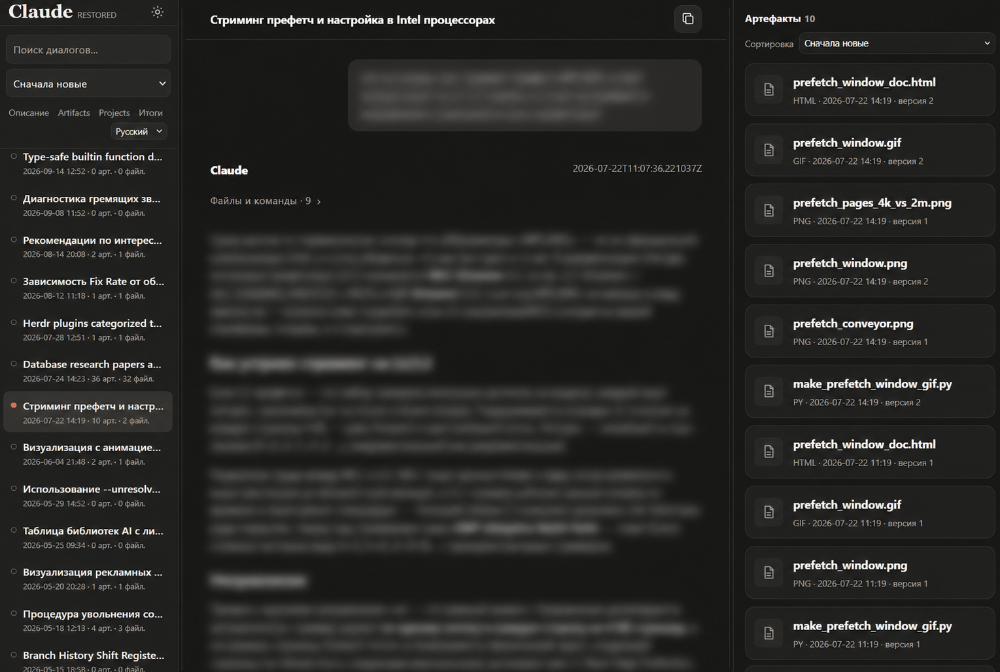
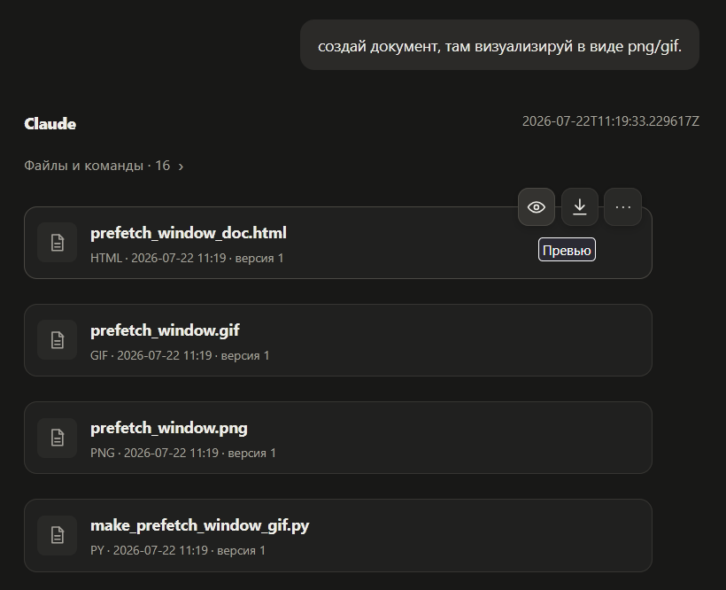
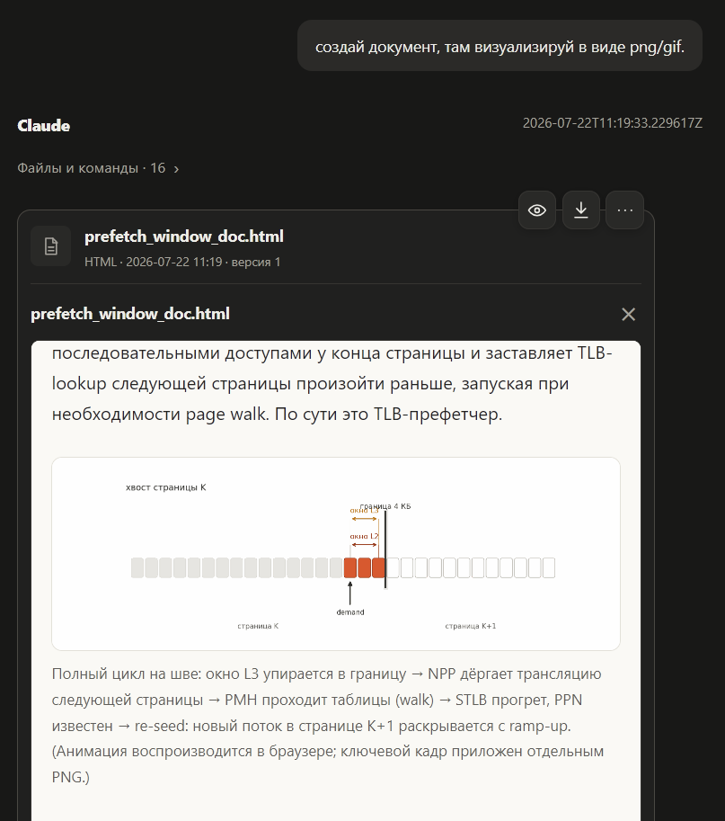
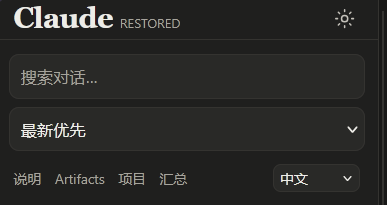
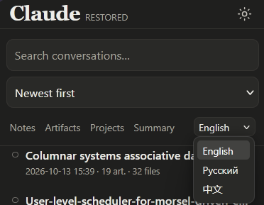

# Восстановление экспорта Claude · Claude 导出恢复

[Русский](#русский) · [中文](#中文)

## Русский

Проект превращает ZIP-файлы экспорта Claude в локальный HTML-архив с поиском по чатам, карточками вложений и превью артефактов.

Из ZIP извлекаются сообщения, вложения и журналы вызовов инструментов. По журналам восстанавливаются исходники и команды сборки. Если сохранились нужные материалы, конвейер пересоздаёт артефакты (PPTX, DOCX, XLSX, HTML, PDF), восстанавливает даты выдачи и добавляет ссылки в чаты.

[Инструкция по восстановлению](RESTORE_NEW_CLAUDE_EXPORT.md) · [Устройство проекта](AGENTS.md)

## 中文

本项目将 Claude 导出的 ZIP 文件转换为可在本地浏览的 HTML 归档，支持搜索对话、查看附件卡片和预览产物。

流程先从 ZIP 中提取消息、附件和工具调用日志，再根据日志还原源文件和构建命令。材料齐全时，流程会重新生成 PPTX、DOCX、XLSX、HTML 或 PDF，恢复原始交付时间，并在对话中添加链接。

[恢复指南](RESTORE_NEW_CLAUDE_EXPORT_zh.md) · [项目结构](AGENTS.md)

## Скриншоты · 截图

**Диалог и список артефактов · 对话和产物列表**

**Карточки и превью в чате · 对话中的卡片和预览**

**Китайский интерфейс и выбор языка · 中文界面和语言切换**

